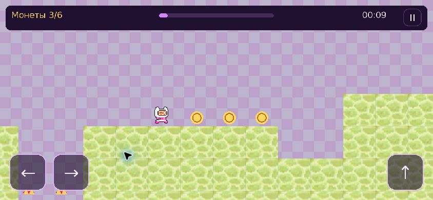

# StarJump

[](https://github.com/Scirtor/StarJump/actions/workflows/build.yml)

[Download Android preview and web edition](https://github.com/Scirtor/StarJump/releases)

A single-level platformer by Nurzhan Bekmurat (Scirtor), rebuilt from the May 2024 college graduation project for desktop browsers, Android and iPhone. An offline Android APK wrapper is also included. Reach the star above the lunar tower with movement and a double jump.

## What changed

- Fixed 60 Hz simulation, independent of drawing frequency; jump buffering and a short edge grace period.
- Shared decoded textures, cached animation frames and text, precomposed background, spatial collision lookup and viewport culling.
- Adaptive portrait/landscape canvas with a bounded render resolution, safe areas and simultaneous movement/jump touch buttons.
- Three checkpoints, six coins, finish screen, best time and versioned local progress. Continuing starts at the last checkpoint; collected coins persist.
- Automatic pause on focus loss/rotation; no catch-up after background suspension. Menus render at a lower frequency.
- Installable PWA shell, home-screen icons, Android installation prompt, Safari instructions and offline caching after a successful online launch.

The original source remains untouched in its original folder; a reference copy is in `legacy/`. The 362-block level geometry, original character, terrain and menu artwork are retained. The finish condition and checkpoint flags are new. Collision uses a consistent rectangular player body instead of rebuilding pixel masks every frame.

## Play and controls

On a computer: arrows or A/D, Space/W/Up to jump, a second press in the air for the double jump, Esc to pause. On a phone: hold a movement arrow and tap jump with another finger. Rotation pauses the game. Browser storage is local to the current origin and browser; private mode, clearing site data or changing the domain can remove/separate progress.

## Development

Python 3.12 or 3.13 is recommended (the tested desktop interpreter is 3.13).

```sh
python -m venv .venv
.venv/bin/pip install -r requirements-dev.txt
.venv/bin/python main.py
.venv/bin/python -m pytest -q
node --test tests/service-worker.test.cjs
```

The packaged browser runtime is Pygbag 0.9.3 / Python 3.12 / pygame-ce 2.5.7; the desktop dependency is pygame-ce 2.5.8. Keep the explicit `import pygame` in `main.py`: Pygbag's preload scanner needs it.

## Build and preview

```sh
.venv/bin/python tools/build_web.py
.venv/bin/python tools/preview.py --port 8766
```

Open **http://127.0.0.1:8766/**. Use the numeric loopback address: Pygbag treats `localhost` as its own development package server. The web release archive is **`dist/StarJump-web.zip`**; extract it to a static HTTPS directory, including `sw.js` and `manifest.webmanifest`. No Python backend or database is required. Serve WebAssembly as `application/wasm`, the manifest as `application/manifest+json`, and allow revalidation of `sw.js` and HTML. The game supports a subdirectory as well as a domain root.

The first run downloads the Python/WebAssembly runtime from the versioned pygame-web CDN plus about 3.2 MiB of game data. Its runtime files are cached by the service worker before gameplay. The offline indication appears in the installation help after successful caching. The browser can evict cached files when storage is low; reconnect and launch once to restore them. New builds refresh the game cache while preserving the versioned runtime and saved progress.

`stage.apk` inside the web archive is a ZIP asset bundle for the Pygbag itch.io loader, **not an Android application**. The installable release is the website. itch.io's embedded player can run the game; home-screen installation should use its own HTTPS address.

## Android APK

The Android application bundles the game, CPython/WebAssembly runtime and pygame wheel. It loads its own HTTPS asset origin in Android System WebView and declares **no internet or storage permission**. It does not need a running server, a domain or an online first launch. Its save data belongs to the installed app and is separate from the browser/PWA save.

The downloadable **`StarJump-Android-preview.apk`** is a real, debug-signed Android package. It requires Android 8+ and a current Android System WebView. This is a test release for manual installation, not a Google Play release. Debug certificates generated by fresh CI environments may differ between builds; production distribution needs a separately managed, persistent release signing key. No signing key is committed.

To build with an already configured Android SDK 35, Java 21 and Gradle 8.13:

```sh
.venv/bin/python tools/prepare_android.py
gradle --no-daemon -p android assembleDebug lintDebug
```

APK output: `android/app/build/outputs/apk/debug/app-debug.apk`. GitHub Actions performs the same build and publishes a preview download for version tags. Runtime downloads are pinned by SHA-256 in `tools/android-runtime-lock.json`; they are build inputs, not tracked binary files. The original level and artwork stay in the repository.



## Verification

- 25 game tests and three additional Android bundle checks: collision lookup, negative coordinates, landing, wall/ceiling collisions, double jump, checkpoints/hazards, frame-rate independence, pause, multitouch, touch/mouse deduplication, saves and screen layouts.
- A complete input-only replay (`tests/completion-route.json`) reaches the star in 2,606 simulation steps without deaths or teleportation. `tools/find_route.py` can search for another route after geometry/physics changes.
- A JavaScript worker test checks cache installation, preservation of unrelated caches and offline game/runtime responses.
- Chrome browser checks at 390×844, 844×390 and desktop size. The final build also reloaded and resumed with the local static server stopped; a complete device network disconnect was not simulated. Actual Android Chrome and iPhone Safari hardware installation/touch testing is still required before calling this a fully verified mobile release.
- Performance measurement: `tools/benchmark.py`, 300 frames, three unprofiled runs of each version, same process and SDL dummy display. Median old 4.316 s, new 0.763 s (about 5.7× less elapsed time in this stationary start-scene test, including setup and presentation). This is **not a phone FPS measurement**. At the start, 44 of 362 blocks are drawn, collision lookup considers two nearby blocks, and the new version loads ten images at startup with no repeated game-loop file reads. See `artifacts/benchmark.json`.

## Provenance

See `SOURCE.json`. Existing artwork was supplied with the author's graduation project; this repository does not assign a new license to those assets. The UI font is DejaVu Sans; its bundled license is `assets/FONT-LICENSE.txt`. BrowserFS 1.4.3 is vendored from the pinned npm distribution; its license is `web/vendor/BrowserFS-LICENSE`. Pygbag and the browser runtime retain their upstream licenses.

Installation references: [Apple Safari](https://support.apple.com/guide/iphone/open-as-web-app-iphea86e5236/ios), [Chrome web app installation](https://developer.chrome.com/blog/update-install-criteria).
